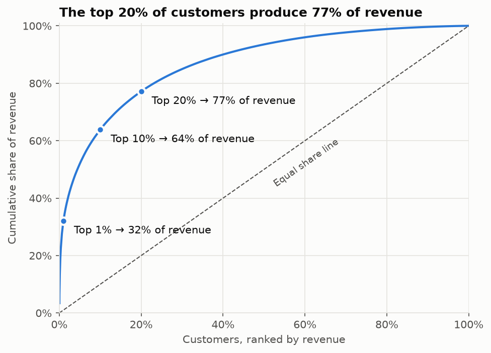
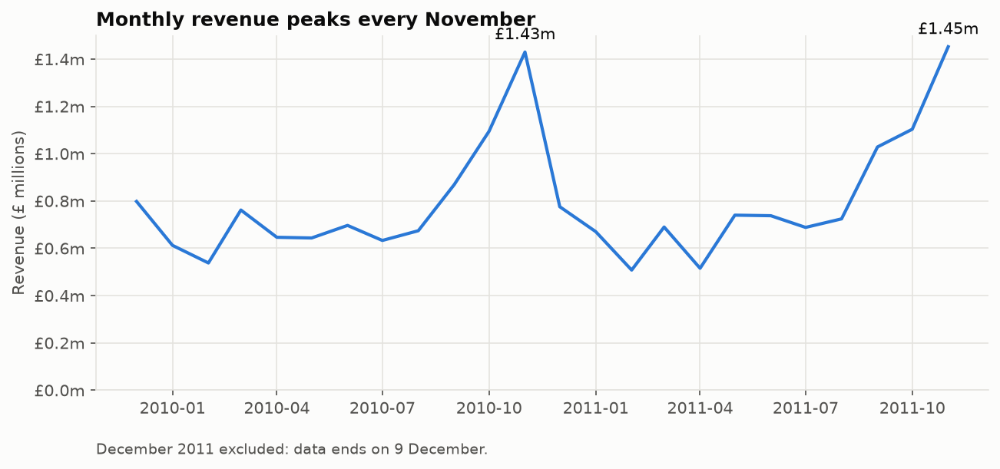
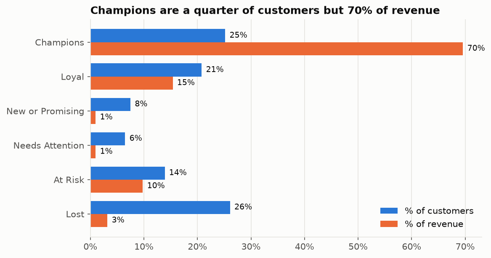
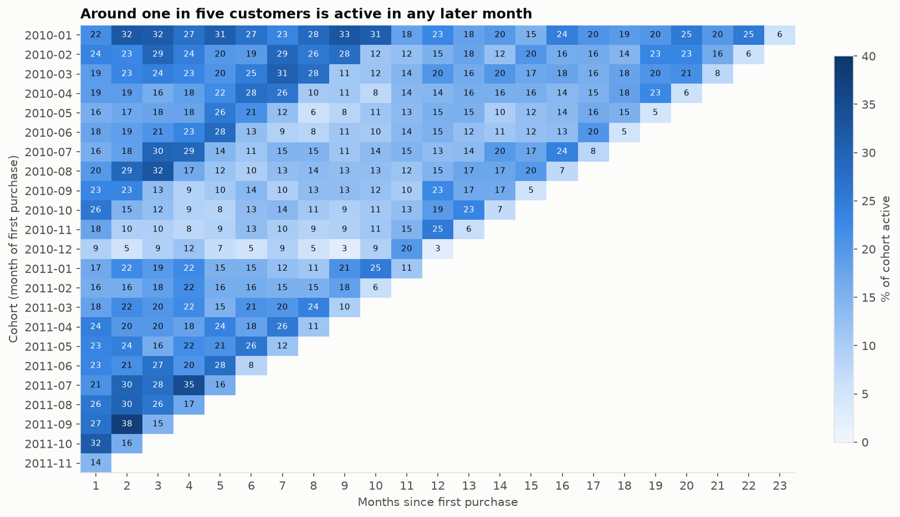
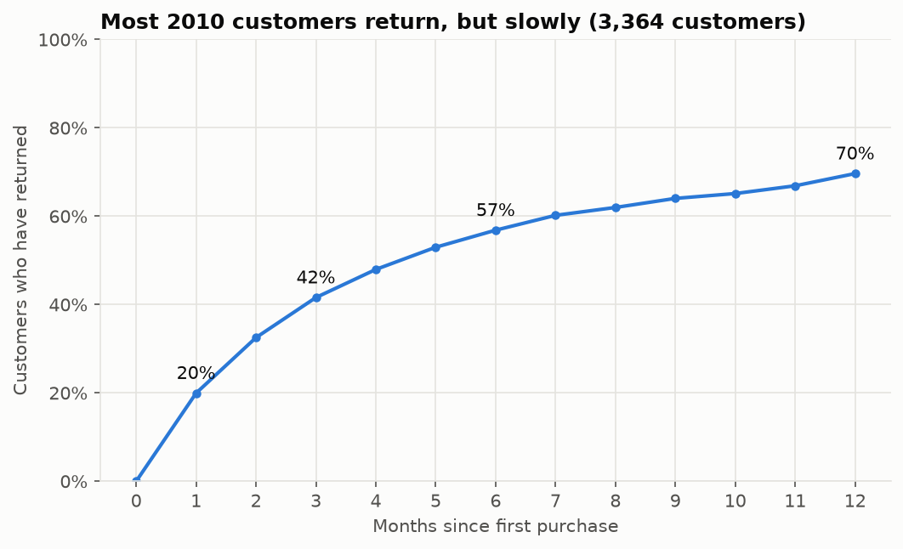

# Retail Customer Analytics: RFM Segmentation and Cohort Retention

A SQL and Python analysis of over one million transactions from a UK online retailer. The core logic is written in SQL, using CTEs and window functions. Python reads the SQL results and builds the charts.

**Headline finding:** the top 20% of customers produce 77% of revenue. Most customers do return, but in seasonal cycles. The clearest retention target is a group of 815 "At Risk" customers who spent £1.68 million in total but have not ordered for a year.



## The Question

The retailer sells gift-ware to shoppers and trade buyers. This project asks where the retailer should focus its customer retention effort.

Three hypotheses were tested:

| Hypothesis | Result |
|---|---|
| 1. Revenue is concentrated in a small share of customers | **Supported.** The top 1% of customers produce 32% of revenue, and the top 20% produce 77%. |
| 2. Most customers do not make a second purchase | **Not supported.** 70% of customers who first bought in 2010 returned within a year. |
| 3. Retention is higher than a typical online shop, because many customers are wholesalers | **Supported.** Long-term return rates are high, and buying peaks every autumn. |

## Key Findings

**Buying is strongly seasonal.** Revenue peaks every November at about £1.4 million. Most other months sit between £0.5 million and £0.8 million.



**A quarter of customers produce 70% of revenue.** Customers were scored on recency, frequency and monetary value (RFM) and placed in six segments. The At Risk segment spent almost as much per customer as the Loyal segment, but its last order was a year ago on average.



| Segment | Customers | % of revenue | Average spend | Average days since last order |
|---|---|---|---|---|
| Champions | 1,476 | 69.6% | £8,051 | 20 |
| Loyal | 1,219 | 15.4% | £2,162 | 77 |
| New or Promising | 436 | 1.0% | £390 | 27 |
| Needs Attention | 379 | 1.0% | £431 | 107 |
| At Risk | 815 | 9.8% | £2,060 | 365 |
| Lost | 1,527 | 3.2% | £352 | 456 |

**Customers return, but not every month.** In any single month, only about one in five customers from a cohort places an order. However, the share who have returned at least once keeps rising. It reaches 42% by month 3 and 70% by month 12.





## Recommendations

1. **Win back At Risk customers first.** They hold £1.68 million of past spend and stopped ordering recently enough to be won back. Contact should start before September, ahead of the autumn restocking period.
2. **Protect the Champions.** 59 accounts produce almost a third of revenue. Losing a few of them would have a large effect.
3. **Encourage the second order early.** Over half of returning customers come back within six months.
4. **Limit spending on Lost customers.** They are the largest group but spent little.

## Method

```
Excel workbook ──> CSV ──> SQLite database ──> sales_clean view ──> SQL analysis ──> Python charts
  (UCI source)     src/01    src/02 + sql/01      sql/02             sql/03 to 05     notebooks/01
```

1. **Load.** A Python script combines the two Excel sheets and loads them into four normalised tables: `customers`, `products`, `invoices` and `invoice_lines`. The schema has primary keys, foreign keys and indexes. The load ends with a row count and a revenue reconciliation against the source.
2. **Clean.** A SQL view, `sales_clean`, removes cancellations, returns, zero prices and non-product codes such as postage and fees. Every cleaning rule is recorded with its reason in the [decision log](docs/DECISIONS.md).
3. **Analyse in SQL.** Headline figures, monthly revenue, revenue concentration, RFM scores and cohort retention.
4. **Visualise in Python.** The notebook reads each SQL file through SQLAlchemy, so the SQL and the analysis cannot drift apart.

### SQL Techniques Used

| Technique | Where |
|---|---|
| DDL with primary keys, foreign keys and indexes | [`sql/01_schema.sql`](sql/01_schema.sql) |
| A view with joins across four tables | [`sql/02_views.sql`](sql/02_views.sql) |
| CTEs, subqueries and `CASE` | [`sql/03_overview.sql`](sql/03_overview.sql) |
| Running totals with `SUM() OVER (ORDER BY ...)` and `ROW_NUMBER()` | [`sql/03_overview.sql`](sql/03_overview.sql) |
| Quintile scoring with `NTILE(5)` | [`sql/04_rfm.sql`](sql/04_rfm.sql) |
| `MIN() OVER (PARTITION BY ...)`, a self-join and conditional aggregation | [`sql/05_cohorts.sql`](sql/05_cohorts.sql) |

## Data

**Online Retail II**, UCI Machine Learning Repository. All transactions of a UK-based online retailer from 1 December 2009 to 9 December 2011: 1,067,371 invoice lines.

Chen, D. (2012). Online Retail II [Dataset]. UCI Machine Learning Repository. https://doi.org/10.24432/C5CG6D

Licensed under [CC BY 4.0](https://creativecommons.org/licenses/by/4.0/). The raw data is not stored in this repository. See the [data dictionary](data/README.md) for the columns, quality checks and download steps.

## Limitations

- The data starts on 1 December 2009. Some customers who appear new in early 2010 may be existing customers.
- December 2011 holds only nine days of data. It is excluded from the monthly charts and the heatmap.
- The analysis uses revenue, not profit. The data has no costs or margins.
- 13.1% of revenue has no Customer ID. It is included in revenue totals but not in the customer analysis.
- The wholesale customer base is inferred from the source description and order values. It is not recorded in the data.

## How to Reproduce

1. Clone the repository and create a virtual environment:
   ```
   python -m venv .venv
   .venv\Scripts\Activate.ps1
   pip install -r requirements.txt
   ```
2. Download the dataset from the [UCI page](https://archive.ics.uci.edu/dataset/502/online+retail+ii). Extract `online_retail_II.xlsx` into `data/raw/`.
3. Build the database:
   ```
   python src/01_xlsx_to_csv.py
   python src/02_load_sqlite.py
   ```
4. Open `notebooks/01_analysis.ipynb` and run all cells.

## Repository Structure

| Folder | Contents |
|---|---|
| `data/` | Data dictionary. The raw files are not committed. |
| `docs/` | [Project plan](docs/PLAN.md), [decision log](docs/DECISIONS.md), [findings log](docs/FINDINGS.md) and [output mock-up](docs/MOCKUP.md) |
| `notebooks/` | `00_first_look.ipynb` (data profiling) and `01_analysis.ipynb` (the narrated analysis) |
| `output/` | Charts and the segment summary table |
| `sql/` | Schema, view and analysis queries |
| `src/` | Scripts that convert and load the data |

The full history of changes is in the [changelog](CHANGELOG.md).

## Tools

SQLite · SQL · Python 3.10 · pandas · SQLAlchemy · matplotlib · Jupyter · Git

## Author

Nick Flora. [GitHub](https://github.com/njflora)
